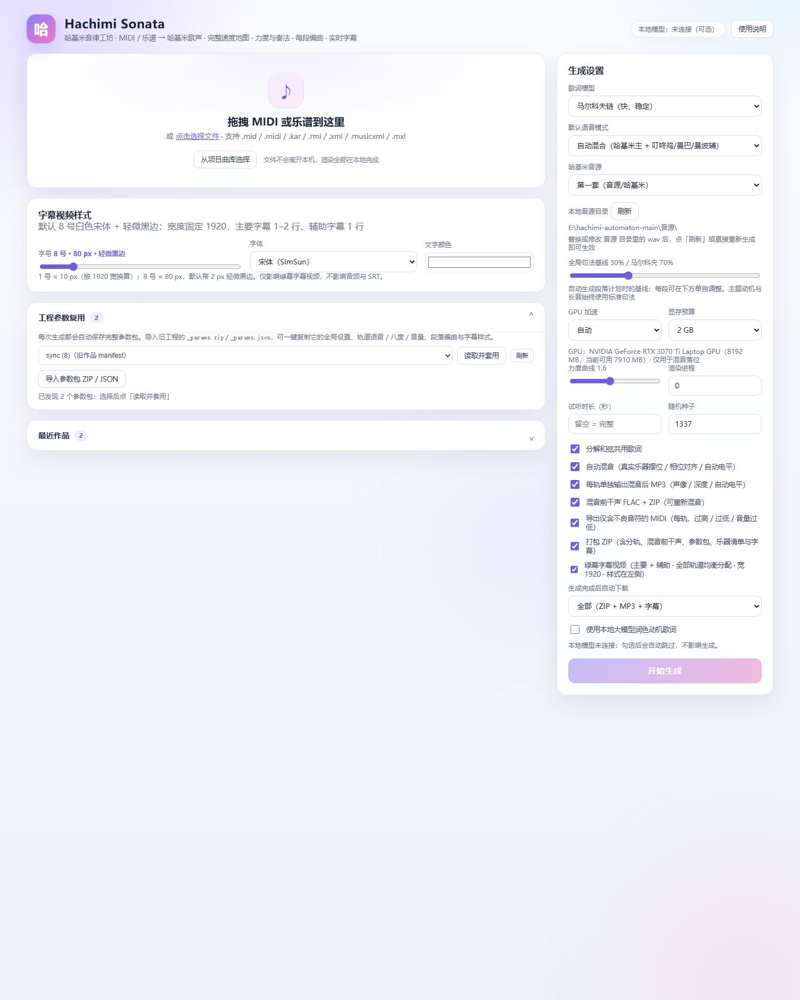

# Hachimi Sonata · 哈基米音律工坊

把一个 **MIDI 或 MusicXML / MXL 乐谱**变成「哈基米 / 叮咚鸡 / 曼巴」歌声：
自动分析轨道、乐器、调性、和弦级数、段落与乐句，提取重复动机，按
**每段独立的标准句法 / 马尔科夫比例**与音源配比分配歌词。MusicXML 会完整读取
**全部速度标记、力度与渐强渐弱发夹、断奏 / 重音 / tremolo / 连音线**，按谱面位置
换算成精确的秒级时间轴；每个音源先做强压缩与响度补偿，并分析齿音和清辅音、
压低这类噪声性/无周期成分，再按力度做渐强渐弱，极端高/低音自动做频段可听度补偿；
每个音起音做软包络弱化音头，连续单声部音之间做尾部延伸 + 柔起音的连奏过渡；
所有辅音统一压低，基 / 库 / 叮 / 咚等爆破音开头额外大幅削减；最后按真实乐器摆位
自动混音（相位对齐、早期反射、自动电平；3.4:1 总线压缩 + 自动补偿 + 弱段提升，
保留流媒体安全的动态余量），同步输出
**MP3 音频 + 混音后分轨 + 混音前 FLAC 干声包 + 实时字幕文档 + 乐器清单 + 工程参数包 +
一条宽 1920、包含全部轨道字幕、每次最多 1 行、默认 8 号白色宋体 + 轻微黑边的绿幕字幕视频**。
同时检查过高 / 过低 / 实际音量过低的不良音符，并为每条问题轨道导出只含不良音符的 MIDI；另导出「补充 MIDI」：先列不良音轨，再用空白轨分隔，最后是谱面全部轨道，一次就能对照问题音与完整配器。MusicXML 的 `<unpitched>` 打击乐会按 GM 鼓音高解析，并单独导出带 `_NOAUDIO` 标记的打击乐 MIDI。

> 本仓库基于 [connoryyan/hachimi-automaton](https://github.com/connoryyan/hachimi-automaton)
> 重构，并已作为独立工程继续开发：品牌与工程标识改为 **`hachimi-sonata`**，
> 一键启动默认打开 **`http://localhost:8787`**（保证所有浏览器可访问），
> 品牌域名 **`http://hachimi-sonata.localhost:8787`** 作为可选入口，
> 不再使用旧工程的 `hachimi-automaton` / `localhost:8765`，避免与已有工程重复。

---

## 目录

- [快速开始](#快速开始)
- [网页界面](#网页界面)
- [命令行](#命令行)
- [输出文件](#输出文件)
- [算法说明](#算法说明)
- [性能优化](#性能优化)
- [目录结构](#目录结构)
- [相对上游的修复](#相对上游的修复)
- [常见问题](#常见问题)
- [测试与开发](#测试与开发)

---

## 快速开始

### Windows 一键启动

1. 安装 **Python 3.10+**（安装时勾选 *Add Python to PATH*）。
2. 双击 **`安装依赖.bat`** 安装依赖。
3. 双击 **`一键启动.bat`**（推荐；也可用 `start.bat` 查看控制台）：
   启动器会自动启动服务，等服务真正就绪后再打开浏览器（Windows 下优先 /
   回退到 Microsoft Edge），地址为 **`http://localhost:8787`**。
   品牌域名 `http://hachimi-sonata.localhost:8787` 会同时显示，浏览器支持时可使用；
   若 Edge / 默认浏览器仍未弹出，启动器日志会给出失败原因，也可手动打开
   `http://127.0.0.1:8787`。

> **安全验证提示**：`HachimiSonata.exe` 是本地编译的未签名程序，Windows Smart App Control /
> SmartScreen 或部分安全软件可能拦截它。**不要关闭系统安全功能**，改用
> `一键启动.bat` 或 `start.bat` 即可：它们调用系统已签名的
> `pyw.exe` 来运行 Python 启动器，不会触发 exe 的签名检查。

也可以双击 `start.bat`（带控制台，便于排查）、`start_web.bat` 或 `启动器.pyw`。
所有入口都会使用同一个启动器与图标。

### 命令行

```bash
pip install -r requirements.txt

python main.py                     # 交互式：选择 MIDI / 乐谱 / 模型 / 轨道
python main.py song.mid --yes      # 使用默认参数直接生成
python main.py song.musicxml --yes # 读取 MusicXML / MXL
python main.py web                 # 网页界面（自动打开浏览器）
python main.py analyze song.xml    # 只做分析（含速度地图 / 力度 / 奏法）
python main.py launch              # 图形启动器
```

### 依赖说明

| 依赖 | 用途 |
| --- | --- |
| numpy / scipy | 数值计算、滤波 |
| scipy / soundfile | 重采样、滤波与音频读写 |
| pyworld | WORLD 声码器（人声合成核心） |
| pretty_midi / mido | MIDI 解析 |
| xml.etree / zipfile | MusicXML / MXL 解析（Python 标准库，无需额外安装） |
| fastapi / uvicorn | 网页后端 |
| matplotlib / networkx | 马尔科夫转移图（可选） |

> Windows 上若 `pyworld` 编译失败，可用 conda：
> `conda install -c conda-forge pyworld`，其余依赖继续用 pip。
>
> **GPU（可选）**：安装 CUDA 版 PyTorch 后自动启用混音加速：
> `pip install torch --index-url https://download.pytorch.org/whl/cu124`。
> 不安装也能正常生成（CPU）。默认显存预算 2GB，且不会超过总显存 1/4。

---

## 网页界面



1. **拖拽 MIDI 或乐谱**（`.mid` / `.midi` / `.kar` / `.xml` / `.musicxml` / `.mxl`）
   到虚线区域，或点击「从项目曲库选择」。
2. **最近作品**在左栏顶部，默认折叠，点击标题展开；展开状态会记住。
   可试听 / 下载最近生成的作品，不会离开本机。
   - 左栏「字幕视频样式」默认 **8 号白色宋体 + 2px 黑边**，可调字号（4~30 号）、
     字体（宋体 / 微软雅黑 / 黑体 / Noto Sans SC / 等线）和文字颜色；
     只影响绿幕字幕视频，不影响音频与 SRT。
   - 左栏「工程参数复用」：自动列出每个作品的参数包（旧作品回退到 `manifest.json`），
     选择后一键复制全局设置、轨道语音 / 八度 / 音量、段落编曲与字幕样式；
     也可直接导入别处的 `*_params.zip` / `*_params.json`。
3. 分析完成后会列出：
   - 每条轨道的**乐器名、角色（旋律/和声/低音声部/铺底/打击乐）、音符数、最高音、平均力度**；
   - **全曲调性**（Krumhansl-Schmuckler 大调/小调轮廓）、**和弦时间轴与罗马数字级数**、
     **段落结构**（A/B/A′ …，含每段调性、和声进行、小节数与能量）、**乐句**（A1/A2 …）；
   - **重复动机**（音程 + 出现次数）与音高轮廓 / 密度 / 段落的可视化；
   - MusicXML 来源额外显示**速度变化次数、力度标记数、奏法标记数**，并展开
     **速度变化明细表**（时间 / BPM / 谱面标记）；密集自动化会标明聚合窗口。
4. **勾选参与生成的轨道**（打击乐默认关闭；最高音 < 60 的轨道标为「低音声部」，
   默认不勾选且音量降到 0.35，仍可手动勾选；**小提琴默认音量 1.50**），逐轨设置：
   - **语音模式**：自动混合 / 哈基米 / 哈基米only / 曼波 / 曼波only / 叮咚鸡 / 曼巴；
   - **哈基米音源**：第一套（`音源/哈基米`）/ 第二套（`音源/哈基米第二版`）；
   - **八度偏移**（-3 ~ +3）；
   - **音量**（0 ~ 2）。
5. **段落编曲**：每个段落可单独设置
   - **马尔科夫比例**（默认 70%，手动可调 0~100%；自动计划默认落在 50~90%）；
   - **随机种子**（每段独立）；
   - **音源配比**：哈基米 / 叮咚鸡 / 曼巴 / 曼波（自动归一化，哈基米默认 76%、
     叮咚鸡 16%、曼巴 5%、曼波 3%，保证哈基米绝对主导、叮咚鸡辅助）。
   支持逐段手动修改、恢复自动、按全局基线重建。
6. 调整全局设置（模型、**全局句法基线**、力度曲线、渲染进程、
   **GPU 加速与显存预算**、试听时长、随机种子、分解和弦开关、
   **自动混音**、**混音后分轨 MP3**、**混音前 FLAC 干声包**、**不良音符 MIDI**、
   **ZIP 打包**、**绿幕字幕视频**、**自动下载**）。
   自动混音默认开启：按乐器家族真实摆位、直达声相位对齐、按深度加入早期反射，
   并在用户音量基础上做 ±6dB 自动电平；总线以 3.4:1 压缩 + 自动增益补偿 +
   弱段向上压缩做动态整理，最后以 -14dBFS RMS 为目标做母带响度
   （峰值限制器会按素材的瞬态把实际值保持在约 -17~-14dBFS，避免削波）。
7. 点击 **开始生成**。渲染过程中：
   - 进度条 / 阶段 / 实时日志；
   - **实时字幕**在歌词生成后立刻推送（不需要等音频完成）；
   - 完成前会执行**和弦发声校验**。
8. 完成后可在线试听；顶部显示和弦发声校验与不良音符检查结果，下载区提供：
   - **打包下载 ZIP**（MP3 混音 + 混音后分轨 + 混音前 FLAC 干声包 + 参数包 + 乐器清单 + 全部字幕/分析/校验 + 绿幕视频 + 不良音符 / 补充 / 打击乐 MIDI）；
   - 混音 MP3、每条轨道的独立 MP3、每条轨道的混音前 FLAC、SRT/LRC/HTML/Markdown、参数包；
   - 每条问题轨道的**仅含不良音符 MIDI** 与合并版；
   - **补充 MIDI**：不良音轨（`*_NG`）→ 空白分隔轨 → 谱面全部轨道（完整音符），所有 MIDI 轨名均为英文；未参与音频合成的轨道名带 `_NOAUDIO`；
   - **打击乐 MIDI**：单独一条文件，含全部鼓轨，轨名带 `_NOAUDIO`；
   - **绿幕字幕视频**（单条文件包含全部轨道字幕；每次最多 1 行；宽 1920、默认 8 号白色宋体 + 黑边、纯绿底、30fps、无音轨）。
   - 默认**自动下载** ZIP + 混音 MP3 + SRT/LRC + 每条分轨 MP3
     （可在设置里改成仅 ZIP 或关闭）。

> 默认网页地址：`http://localhost:8787`（保证可打开）；备用：`http://127.0.0.1:8787`。
> 品牌域名：`http://hachimi-sonata.localhost:8787`（部分浏览器/IPv6 环境可能不可用）。
> 端口可用 `--port` 或 `HACHIMI_PORT` 修改。
> 所有处理都在本机完成，MIDI / 乐谱不会上传到云端。

---

## 命令行

```text
python main.py [目标] [选项]

目标:
  <song.mid>        直接渲染该 MIDI
  <song.xml>        直接渲染 MusicXML / MXL
  web / serve       启动网页服务
  launch / gui      启动图形化启动器
  analyze <song.xml> 只分析

选项:
  --midi, -m PATH        MIDI / MusicXML 路径
  --out, -o DIR          输出目录（默认 output/<曲名>）
  --project NAME         项目名
  --model markov|transformer   歌词模型
  --voice auto|哈基米|哈基米only|曼波|曼波only|叮咚鸡|曼巴
  --sample-set 1|2       哈基米音源：1=音源/哈基米，2=音源/哈基米第二版
  --tracks 0,1,2|all     参与生成的轨道
  --syntax-weight 0.3    标准句法权重（1-该值 = 马尔科夫）
  --gamma 1.6            力度曲线指数
  --workers N            渲染进程数（0=自动）
  --audio-format mp3|wav 混音 / 分轨格式（默认 mp3；混音前干声固定 FLAC）
  --gpu auto|on|off      GPU 加速（默认 auto）
  --gpu-memory-mb 2048   GPU 显存预算（默认 2GB，8G 显卡不会吃满）
  --max-seconds S        只渲染前 S 秒（快速试听）
  --tail-seconds S       混响尾巴秒数（默认 3；试听可设 0 得到精确 S 秒）
  --no-decomposed        关闭分解和弦合并
  --no-auto-mix          关闭自动混音（真实摆位 / 相位 / 自动电平）
  --no-stems             不输出混音后的每轨音频
  --no-premix            不输出混音前 FLAC 干声包
  --no-bad-notes         不导出不良音符 / 补充 MIDI
  --no-zip               不打包 ZIP
  --no-videos            不生成绿幕字幕视频（默认单条包含全部字幕、每次 1 行）
  --seed N               随机种子
  --yes, -y              全部使用默认值，不交互
  --list                 列出项目内 MIDI / MusicXML
  --port / --host / --no-browser / --verbose
```

交互模式下，每条轨道会依次询问「是否参与 / 语音模式 / 八度 / 音量」，
直接回车接受方括号中的默认值；输入 `a` 表示其余轨道全部接受默认。

---

## 输出文件

输出目录：`output/<曲名>/`

| 文件 | 说明 |
| --- | --- |
| `<曲名>.mp3` | 44.1kHz 立体声人声混音（默认 MP3） |
| `<曲名>_lyrics.json` | 逐音符事件（时间、轨道、音高、力度、歌词、和弦、段落、语音） |
| `<曲名>_subtitles.srt` | 标准 SRT 字幕（可导入剪辑软件 / 播放器） |
| `<曲名>_subtitles.lrc` | LRC 歌词（音乐播放器） |
| `<曲名>_subtitles.json` | 字幕时间轴 + 元信息（供二次开发） |
| `<曲名>_subtitles.md` | Markdown 歌词表格 |
| `<曲名>_realtime.html` | **独立实时字幕播放器**：双击打开即可卡拉 OK 跟唱 |
| `<曲名>_analysis.json` | 轨道 / 调性 / 和弦级数 / 段落 / 乐句 / 动机分析结果 |
| `<曲名>_verification.json` | **和弦发声校验报告**（每个和弦音是否都已渲染/发声；断奏 gate 按谱面原始时值校验） |
| `<曲名>_bad_notes.json` | **不良音符报告**：过高 / 过低 / 实际音量过低、判定阈值与每轨数量 |
| `<曲名>_params.json` | **工程参数包**：全局选项、轨道语音 / 八度 / 音量、段落编曲、字幕样式 |
| `<曲名>_params.zip` | 只含参数 JSON 的小压缩包，可直接发给别人复用 |
| `<曲名>_instrument_report.md` | **乐器输出清单**：输出乐器、对应音频文件名、未输出乐器及原因 |
| `<曲名>_instrument_report.csv` | 同一清单的表格版（Excel 可直接打开） |
| `<曲名>_instrument_report.json` | 同一清单的 JSON 版（供二次开发） |
| `stems/<乐器>_<轨道号>_<语音>_<八度>.mp3` | **混音后**的每轨 MP3，例如 `Cello_02_自动混合_+0.mp3`；已做声像 / 深度 / 自动电平，与混音等长，可直接在 DAW 中叠加 |
| `stems/stems.json` | 分轨索引：轨道名、乐器、语音、八度、音量、声像、深度、自动电平、音符数、响度、峰值 |
| `stems_premix/<同名>.premix.flac` | **混音前**干声：已做系统低切 / 防削波，未做声像、深度、自动电平与混响；FLAC 无损压缩 |
| `stems_premix/stems_premix.json` | 混音前干声索引与处理阶段说明 |
| `<曲名>_stems_premix.zip` | 全部混音前干声 + 索引统一打包，方便重新混音 |
| `bad_notes/trackN_bad.mid` | 该轨**只包含不良音符**的新 MIDI（合格音符全部剔除） |
| `bad_notes/<曲名>_bad_notes.mid` | 全部问题轨道的合并版，便于快速检查 |
| `bad_notes/<曲名>_bad_and_all.mid` | **补充 MIDI**：不良音轨（`*_NG`）→ 空白分隔轨 → 谱面全部轨道；英文轨名（如 `violin1_NG` / `violin1`），未参与音频合成的轨道加 `_NOAUDIO`，保留原谱速度地图 |
| `<曲名>_percussion.mid` | **打击乐 MIDI**：全部鼓轨单独导出，保留 GM 鼓音高；轨名带 `_NOAUDIO`（打击乐不进入哈基米音频合成） |
| `trackN.srt` | 每个参与轨道的独立字幕 |
| `videos/subtitle_all_green.mp4` | **全部字幕绿幕视频**：单条文件包含全部参与轨道的歌词槽，任何时刻最多 1 行；宽 1920、纯绿 `#00FF00`、默认 8 号白色宋体 + 2px 黑边居中、30fps、无音轨 |
| `videos/subtitle_all.srt` | 与视频完全同步的单行 SRT 时间轴（剪辑对轨用） |
| `videos/subtitle_videos.json` | 视频规格：画布宽高、字号、字体、绿幕色、句数、歌词槽覆盖与编码耗时 |
| `<曲名>_package.zip` | **整体打包下载**：MP3 混音 + 混音后分轨 + 混音前 FLAC 包 + 参数包 + 乐器清单 + 全部字幕/分析/校验/不良音符 / 补充 / 打击乐 MIDI + 单条绿幕字幕视频 |
| `manifest.json` | 本次生成的完整清单（含 `stats.mix`：母带响度、相关度、每轨摆位） |

`_realtime.html` 与 MP3 放在同一目录，移动时一起移动即可离线使用。
默认同时输出 MP3 分轨与 ZIP；可用 `--no-stems` / `--no-zip` 关闭。

**自动下载**：网页生成完成后会依次自动下载 ZIP、混音 MP3、SRT、LRC 与每条分轨 MP3
（可在「生成完成后自动下载」中改为仅 ZIP / 关闭）。浏览器若询问多文件下载，请允许。
分轨文件名自动包含 **乐器 + 轨道号 + 语音类型 + 八度修改值**，例如
`Cello_02_自动混合_+0.mp3`、`Violin_00_哈基米_+1.mp3`。

**乐器输出清单**（`*_instrument_report.md/.csv/.json`）最多包含九部分：

1. 输出乐器名单（含混音后分轨、混音前 FLAC、不良音符 MIDI 对应文件名）；
2. 输出乐器 → 分轨 / 混音前干声文件名对应表；
3. 仅混入主混音、未单独导出的乐器（关闭分轨时）；
4. 未输出名单及原因（打击乐、低音声部默认静音、未勾选、无音符等）；
5. 自动混音摆位：每轨声像、深度、自动电平、早期反射延时，以及母带响度
   / 峰值 / 立体声相关度；
6. 绿幕字幕视频：单条视频的轨道组、句数、规格、歌词槽覆盖与文件名；
7. 混音前干声包与不良音符统计；
8. 每轨不良音符数量、原因与专用 MIDI，「不良音轨 → 空白 → 全谱」补充 MIDI，
   以及单独打击乐 MIDI 的轨道 / 音高清单；
9. 工程参数包路径与复用方法。

清单和全部分轨一起放进 ZIP，方便交付时核对“哪些乐器出了声、文件叫什么、
在声场里摆在什么位置”。

---

## 算法说明

### 0. 输入格式：MIDI / MusicXML / MXL

`hachimi/score.py` 把 MusicXML 转成与 MIDI 完全相同的 `PrettyMIDI` 时间轴，
因此后续轨道分析、歌词、渲染、字幕不需要两套逻辑。

- **格式**：`.xml` / `.musicxml` 直接解析；`.mxl` 先读 ZIP 内的
  `META-INF/container.xml` 找到根乐谱，再解析。
- **速度地图**：读取每一个 `<sound tempo>` 与 `<metronome>`，按当前声部的
  谱面游标定位（支持 `offset`、小节内变速、`beat-unit-dot`），再把
  “第几个四分音符”换算成秒。所有速度标记都会保留，不会只取第一个 BPM。
- **密集速度自动化**：DAW 导出的乐谱可能在每个 64 分音符写一个速度事件
  （例如 32832 个、BPM 在 37/38 间抖动）。播放仍使用完整 `TempoMap` 精确定时；
  网页只发送最多 60 个按时间窗口取中位数的代表点，并在「速度变化明细」表中
  列出，避免数万个 DOM 节点卡死浏览器。
- **力度**：`<sound dynamics>` 按 MusicXML / MuseScore 的标尺换算成 velocity；
  `<dynamics>` 的 ppp…ffff、fp、sfz 也会读取。`<wedge crescendo/diminuendo>` 与
  `cresc.` / `dim.` 文字会展开为逐音渐强渐弱，长音在音尾继续跟随曲线。
- **奏法**：staccato / staccatissimo 缩短实际发音；tenuto 保持满时值；
  accent / strong-accent / marcato 提高音头力度；pizz. 用短跳音；
  tremolo 用约 11Hz 振幅调制近似；fermata 适度延长。
- **连音线与装饰音**：跨小节的 `tie` / `tied` 合并成一个持续音，
  避免同一个长音被切成多个字；grace note 放到主音前约 80ms。
- **移调乐器**：读取 `<transpose>` 的 `chromatic` / `octave-change`，
  输出实际发声音高（例如 Contrabass 低八度）。
- **反复记号**：`repeat` / `segno` / `coda` / `fine` 目前按单遍播放，并在分析警告中
  明确提示；需要展开反复时，请先在 MuseScore 中展开并重新导出。
- **测试**：`测试/爱之死测试.xml`（10 声部、79 小节、8 处速度标记、278 处力度、
  298 个连音线标记）用于自检；试听只渲染 5 秒，不生成整首 393 秒音频。

### 1. 轨道与乐器分析

读取 MIDI 或 MusicXML 后，对每条轨道统计：GM 乐器名、音符数、音域、平均力度、平均时值、
音符密度、平均复调数（同时发声音符数），并据此推断角色：

- **旋律**：单声部、音域较宽、密度适中；
- **和声**：复调高、密集；
- **低音**：中位音高 < 48 且复调低；
- **铺底 / 复合**：其余情况；
- **打击乐**：`is_drum`，没有音高，默认静音。

同时给出建议的语音模式、八度与音量（网页和 CLI 均可覆盖）。
**GM 小提琴（program 40 / Violin / Fiddle）默认音量为 1.50**，避免持续弦乐在哈基米
采样混音中被淹没；仍可在网页音量滑杆或 CLI 交互中改回。

### 2. 和弦分析

1. 按起音聚簇（默认 60ms 容差）；
2. 使用「时长 × 力度」加权选择和弦音，抑制快速经过音的干扰；
3. 与 16 种和弦模板匹配（大三、小三、减、增、挂二/四、五度、七和弦、加九、六和弦等），
   并考虑低音根音加权；
4. 按时间合并为「和弦窗口」：同和弦、或后一簇的音集是当前和弦音集的子集时合并，
   从而识别**琶音 / 分解和弦**；
5. 输出根音、性质、置信度、涉及声部与音符。

### 3. 调性、结构与乐句分析

- MIDI 用 `pretty_midi` 的拍点估计（失败时用音符间隔估计 BPM）；MusicXML
  直接用完整速度地图生成拍点，并读取乐谱拍号与拍号变化；
- **调性**：用 Krumhansl-Schmuckler 大调/小调轮廓对「时长 × 力度」加权的音级分布做相关，
  输出全曲调性、置信度与备选调；段落再以全曲调性为弱先验单独判断，避免短段乱跳；
- **段落**：以 32 拍为窗口提取 12 维全频 chroma + 12 维低音 chroma +
  4 维节奏/力度/音区/时值特征；与**非相邻**历史窗口做余弦相似度匹配，
  相似则复用段落标签，得到 A/B/A′ 结构；
- **段落和声**：把每个和弦窗口映射为相对段落调性的罗马数字级数（I / vi / V7 …），
  并统计小节数、密度、音区、能量与织体标签；
- **乐句**：按休止（≥1.5 拍）和 4 小节超周期切分，输出 A1/A2/B1… 乐句编号，
  供网页展示和段落编曲使用；
- 段落编号 / 乐句边界也用于自动语音模式与段落计划切换。

### 4. 动机（主题）检测

在每条轨道上提取旋律骨架（每个起音簇取最高音），用
「**音程序列 + 节奏比例**」作为移调不变的签名，统计出现次数 ≥ 2 的片段，
按「长度 × 次数」排序并做重叠抑制，输出动机及其所有出现位置。

### 5. 歌词规则（需求 4）

- **歌词槽**：和弦窗口内按轨道分簇，再把各声部的「第 i 个和弦音组」对齐——
  若不同声部在同一时间位置奏出和弦音（间隔 ≤ 0.38s），则合并为一个槽 →
  不同声部构成同一个分解和弦时使用完全相同的歌词字；
- 同一声部内部的连续音（旋律、单声部琶音）各自独立成槽，避免旋律被压成一个字；
  含非和弦音的组（旋律经过音）也独立成槽，保持歌词流动；
- **动机复用**：同一动机的每次出现都被强制为**逐音相同的歌词**；
  多个动机共享同一批槽时，按「长度 × 出现次数」优先级保留分数更高者，
  保证所有已应用动机的歌词绝对一致；
- **语音流**：按「主声部 + 语音」分别生成歌词，主旋律的字不会被伴奏字交错；
- 语音模式 `auto`：旋律声部始终用哈基米；对位/伴奏声部按**当前段落的音源配比**
  逐槽加权抽取（默认哈基米 76% / 叮咚鸡 16% / 曼巴 5% / 曼波 3%），
  因此哈基米绝对主导、叮咚鸡为主要辅助，曼巴/曼波只做色彩。

### 5.1 段落编曲与每段随机数

每个段落有一份独立计划（`hachimi/arrangement.py`）：

| 字段 | 说明 |
| --- | --- |
| `markov_ratio` | 该段马尔科夫链占比，默认 **0.70**（标准句法 0.30） |
| `seed` | 该段独立的随机种子，决定句式选择与马尔科夫采样 |
| `source_weights` | 该段哈基米 / 叮咚鸡 / 曼巴 / 曼波音源配比，自动归一化 |

- 自动生成时以 70% 为基线，结合段落能量、织体、重复关系与稳定哈希做
  **±18% 的明显对比**，并保证每个自动段至少偏离基线 8%；
  第一段严格为 70%，便于对照；
- 自动音源配比也拉开（哈基米约 58%~90% 主导，叮咚鸡 42%~82% 的辅助份额），
  相邻段落会真正换色，而不是每段都接近默认配比；
- 网页在全局句法基线变化时会保留整套段间差异，只做整体平移；
  「恢复自动」也会回到后端算出的分段计划，不会把所有段压回同一个 70%；
- 主题动机、长音仍强制标准句法；普通乐句按该段比例在标准句法与马尔科夫之间选择；
- 网页可逐段修改比例、种子、配比；修改后该段标记为「手动」，不会被全局滑杆覆盖。

### 6. 音源稳定化、力度与表情（需求 1、2）

音频链分三层，避免“每个字音量忽大忽小、整首又没有力度”：

1. **音源先稳定**（`hachimi/loudness.py` → `condition_sample`）：
   每个采样进入 WORLD 前统一做「去直流 → 24Hz 低切 → 8:1 强压缩
   （阈值 -28dB、4ms 攻击、90ms 释放）→ 齿音 / 清辅音分析衰减 →
   补偿到 -18dBFS 目标响度 → -1dB 峰值保护」。
   这样不同字、不同音源套件的底子一致，模拟真实乐器平稳、持续的发声；
2. **合成单位再归一**：每个 WORLD 合成单位统一到 -20dBFS，并做音高相关的
   频谱塑形；因此音源差异不会破坏乐谱力度；
3. **落位时按乐谱力度塑形**：

```text
gain = (velocity / 127) ** gamma        # 默认 gamma = 1.6
```

   再乘以轨道音量与音高可听度。MIDI 若同一轨相邻音的间隔 ≤ 0.40s，则把下一音的力度
   作为本音终点，用 smoothstep 曲线做**渐强 / 渐弱**；MusicXML 则直接使用谱面
   发夹 / 力度曲线给出的音尾力度；力度差小于 3 不渐变，避免抖动。
   长音、乐句尾部会自然衰减到下一句的力度，而不是每个音一个死音量。

**极端音高可听度**：音高 > C6 时逐步提升 2~7kHz presence 与 8kHz 以上 air，
C7 以上额外 +2~+7dB；低音则补 140Hz 附近厚度并切掉基频以下隆隆声。
合成后再做一次动态频段分析：若高音的高频占比不足，最多再加 +4dB air shelf。
所有补偿都有上限，并通过母带限幅保护，不会因为“让高音听见”而削爆。

### 6.1 齿音与清辅音分析（新增）

`hachimi/loudness.py` 在音源压缩之后做两道检查：

- **齿音（sibilance）**：逐帧计算 **4.5~10kHz 能量占比** 与
  **80~1200Hz 自相关周期度**。只有“高频占比高 + 周期度低”的噪声性帧才判定为齿音，
  然后在 4.5~10kHz 频段内做最多 **-6dB** 的动态衰减；
  元音即使高频泛音多，只要周期度高就不会被误伤；
- **清辅音（unvoiced consonant）**：在采样开头的辅音区（由 `CONS_FRAMES` 指定），
  对周期度低的帧做最多 **-2.5dB** 的整体衰减；浊辅音（m/n/l 等）和元音不处理；
- 合成单位完成后还会再做一次 **-1.8dB** 的轻量去齿音，
  防止高音 presence / air 补偿把残留齿音重新推亮；
- 所有处理都在最终 -18dBFS 归一化之前完成，因此齿音/清辅音相对元音的响度会真正下降，
  而不是被后续补偿重新拉平。

自检中合成齿音段高频能量下降约 **45%**，真实“西”字齿音段下降约 **41%**，
清辅音段下降约 **25%**，元音段保持不变。

### 6.2 辅音与爆破音控制（新增）

`hachimi/loudness.py` 的 `attenuate_consonants` 在合成单位**最终响度归一化之后**
再处理，因此不会被后续补偿重新推高：

- **所有辅音**：按 `CONS_FRAMES` 的辅音区做约 **-3dB** 衰减，随后在 35ms 内
  平滑回到 0dB，元音主体不受影响；
- **爆破音字**：`基 / 鸡 / 库 / 康 / 叮 / 咚 / 大 / 带 / 波 / 巴` 等开头最初约
  **26ms** 再叠加 **-13dB**，起音合计约 **-16dB**，然后在 36ms 内平滑过渡回普通辅音电平；
- 处理只作用于单个音符的最开头，不改变辅音时值，也不影响元音中段拉伸；
- 渲染统计会记录 `n_consonant_notes / n_plosive_notes`，可在网页结果中核对。

自检用 `基 / 库` 对比：起始 20ms 实际能量降低约 **16dB**，200~400ms 元音段
与未处理版本的比值保持在 **1.00 ± 0.02**；串行与多进程两条渲染路径结果一致。

**声库一致性**：`build_render_notes → choose_sample → condition_sample →
synthesize_note → 软起音 / 辅音衰减 → apply_legato → 自动混音` 对哈基米、
叮咚鸡、曼巴、曼波及其 only 模式完全共用，声库只决定取样文件和变体；
别名（如曼波「夏」→「哈」）会先解析成实际采样，再按该采样的辅音帧数 /
爆破音属性处理，不会拿歌词字的参数误压音头。

### 6.3 时值拉伸与长音（新增）

旧算法把整个元音（包括元音起始和收尾）一起线性插值，长音会变成“慢放的字”，
音头变糊、尾音拖沓。现在改为明确的四段结构：

```text
辅音（源时值，完全不动）
→ 元音音头（源时值，保持清晰）
→ 元音中段（唯一拉伸 / 压缩的部分）
→ 元音尾音（源时值，加自然释放）
```

- 源元音按 12% / 中段 / 18% 分成音头、中段、尾音；音头和尾音最多各 4 / 6 帧；
- 目标更长时，音头、尾音**帧数不变**，只把中段拉长；
- 中段拉伸 ≤2.5 倍时用线性插值，保留自然过渡；
  极限长音（>2.5 倍）用**带 3 帧交叉淡化的中段循环**，循环点不会出现断点；
- 目标更短时优先压缩中段，尽量保留音头；
- 合成末尾加 20~45ms 的余弦自然释放；
- 单音符最大合成时长从 6 秒提高到 **10 秒**，覆盖一般弦乐单音的长音需求。

自检用 20→80 帧验证：音头 / 尾音目标帧数完全不变，只有中段 14→74；
0.4s 与 3.0s 两个音符的**合成单位**音头波形相关度 **1.000**，长音中段 RMS 稳定在
0.098~0.100，结尾自然收敛。渲染阶段再单独做软起音包络，不改变合成单位本身：
这样既保留长音内部的一致性，又能按需求弱化每个音的起音瞬态。

### 6.4 弱化音头与连奏过渡（新增）

**弱化音头**（`hachimi/render.py` → `soft_attack_envelope`）：

- 普通音起音用 **14ms 幂曲线软包络**，从 0 平滑升到满音量；
- 爆破音字（基 / 库 / 叮 / 咚 / 巴 / 波等）用更长的 **22ms 软起音**，
  与上面的 -16dB 起始衰减叠加，进一步削掉“啪”的瞬态；
- 前几毫秒上升较慢，削掉采样起音处“啪”的宽频瞬态；
- 包络在落位阶段逐音施加，不进入合成单位缓存，因此同一单位仍可安全复用；
- 串行 / 多进程 / GPU 三条渲染路径都必须把 `sample_id` 传进合成器，
  否则会漏掉辅音与爆破音处理；该问题已修复并由自检覆盖。

**连奏**（`apply_legato`）：

- 同一轨、单声部、相邻两音间隔 ≤ **160ms** 时建立连奏；
- 前音尾部最多延伸 **140ms** 进入后音起音，实际重叠约 35ms；
- 后音使用 **30ms 软起音**，与前音自然释放形成交叉过渡；
- 延伸量受后音长度限制（不会吃掉后音），且遇到第三个持续音（和弦 / 复调）
  直接跳过，不会把和弦声部误连成滑音；
- 校验仍按原始时值匹配歌词事件，连奏延伸不会造成“漏音”误报。

### 6.5 绿幕字幕视频（单条 · 每次 1 行）

`hachimi/video.py` 在音频写完后生成**一条** MP4，包含全部参与轨道的字幕：

| 项目 | 规格 |
| --- | --- |
| 画面 | 固定宽 **1920**；单条视频、单一画布高度；任何时刻最多 **1 行** |
| 排版 | 每行最多 20 个字；超长句只缩小字号，绝不拆成第二行，也不横向裁切 |
| 背景 | 纯绿 **#00FF00**，无渐变 / 阴影 / 边框 |
| 文字 | 默认 **8 号白色宋体 + 2px 黑边**（1 号≈10px，8 号≈80px），水平 + 垂直居中；字号 / 字体 / 颜色均在网页**左侧**可调 |
| 帧率 | 30fps，H.264 / yuv420p，`+faststart` |
| 音轨 | 无（BB 素材 / Chroma Key 用） |
| 轨道分配 | 全部参与轨道的歌词槽先按 `primary_track` 归属，再合并成一条连续时间线；每个槽只出现一次 |
| 时间轴 | 每句一条字幕；≤1 秒的短空隙会保持上一句，减少闪断；真正的间奏仍为纯绿空白 |


**为什么不会漏字**：同一个歌词槽只出现一次；全部槽合并后覆盖所有可听声部。
`subtitle_videos.json` 会记录 `input_slots / covered_slots / missing_slots` 便于核对。
多个声部同时唱不同字时，会按时间顺序收进同一行，而不是叠成多行。

**为什么只有一行**：`max_lines=1` 会关闭自动换行；若某句在默认 8 号下超过画布宽度，
则逐级缩小字号直到整句放进 1920 宽画面，保证任何时刻都只有一行。
侧车 `subtitle_all.srt` 与视频共用同一条序列化时间轴，同样不会出现同一时刻两行。

**样式控制**：左侧「字幕视频样式」默认 **8 号白色宋体 + 2px 黑边**，可调字号 4~30 号、
字体（宋体 / 微软雅黑 / 黑体 / Noto Sans SC / 等线）和文字颜色。
字号按 1920 宽换算，1 号≈10px；单行高度默认约 1920×168。

**为什么放在音频之后**：音频合成已经占满多核 CPU，ffmpeg 的 x264 也是 CPU
密集型；并发会让两者互相抢核，总时间反而更长、内存峰值也更高。视频只依赖
最终时间轴，所以串行生成是时间最优方案。编码使用「逐句 PNG + concat」，
每句只排版一次，不逐帧 drawtext；长曲也只有几百张静态图。
本机实测：sync (8) 26:44、23 条有词轨道、10,578 个歌词槽 → 664 行单条视频
（1920×168、30fps），编码约 **80 秒**，远低于音频合成时间。
算力不足或不需要时可在设置里关闭。

### 7. 自动混音：真实摆位、相位与母带（需求 3）

`hachimi/mixing.py` 把“混音”从简单求和升级为逐轨摆位：

- **真实摆位**：以听众视角，小提琴左（-0.58）、中提琴左中、大提琴右（+0.30）、
  低音提琴 / 贝斯中央偏右、钢琴左中、竖琴右中、木管中央、铜管右、打击乐后方；
  同家族多轨会轻微错开，避免完全重叠；
- **相位优先**：先检测左右相关度，反相时翻转右声道；直达声用等功率声像，
  不用“故意延时”制造假宽度；只有早期反射按深度延时（8~30ms），
  因此单声道兼容性和相位相关度都保持良好；
- **深度与空间**：越远的乐器高频吸收越多、直达声略低、早期反射与混响发送越大；
  总线只加 5.5% 短房间混响做胶合；
- **自动电平**：旋律 / 和声 / 低音 / 铺底 / 打击乐各有目标 RMS，
  在用户手动音量基础上最多修正 ±6dB；
- **母带动态**：总线压缩从旧版 1.8:1 提升到 **3.4:1**（RMS 包络、14ms 启动、
  220ms 释放、8dB 软拐点），压缩后按整体 RMS **自动补偿增益**（最多 +10dB）；
  对 -36dB 以下的弱段再做最多 **+4.5dB 向上压缩**，因此弱音不会被强音埋掉，
  强音也不会过冲。最后以 **-14dBFS RMS** 为目标，用 6ms 前瞻限幅器压峰值到
  -1dB；峰值因数通常保留在约 9~15dB，适合流媒体回放，但不会像流行音乐母带那样压扁；
  实际响度会因素材瞬态落在约 -17~-14dBFS；
- 分轨使用与主混音**相同的摆位和自动电平**，导出后再做峰值保护，
  因此把分轨重新叠加能得到接近主混音的结果。

网页可在生成前勾选 / 取消「自动混音」；CLI 使用 `--no-auto-mix` 关闭。
关闭后回到逐轨渲染 + 统一后处理的传统模式。

### 8. 分轨、干声、参数包与质量检查

**混音后分轨**：每条参与轨道先渲染干声，再做与主混音相同的声像 / 深度 / 自动电平，
写入 `stems/<乐器>_<轨道号>_<语音>_<八度>.mp3`（如 `Violin_00_哈基米_+1.mp3`）。
与混音严格等长、起点对齐；只做峰值保护，不做整体提升，保留各轨相对音量。
`stems/stems.json` 记录轨道名、乐器、语音、八度、音量、声像、深度、自动电平、
音符数、响度与峰值。

**混音前干声**：同一轮渲染在摆位前另存一份 FLAC（系统低切 / 防削波已做，
未做声像、深度、自动电平与混响），目录为
`stems_premix/<同名>.premix.flac`；全部干声与索引再统一打包成
`<曲名>_stems_premix.zip`。这样既能直接用混音后分轨，也能在 DAW 里重新做声场。

**不良音符 MIDI**（`hachimi/qc.py`）：
- 按轨道八度移调后的实际发声音高检查 **C2~C6**，并检查是否偏离本轨中位数
  两个八度；过高 / 过低均记为「发声困难」；
- 用实际力度（含渐弱终点）、音高可听度与轨道音量估算每个音的相对电平；
  明显低于本轨中位电平，或力度低到几乎听不见，记为「音量过低」；
- MusicXML 的 `p / pp / mp` 与渐弱是作曲意图，默认不判为不良；只有极端弱音
  （力度 ≤8 或绝对电平过低）才记录；
- 每条有问题的轨道导出 `bad_notes/trackN_bad.mid`，**只含所有不良音符，合格音符
  全部删除**；另导出合并版，并把数量 / 原因写入 `<曲名>_bad_notes.json` 与乐器清单。
- **补充 MIDI** `bad_notes/<曲名>_bad_and_all.mid` 固定为三段顺序：
  1. **不良音轨**：每条问题轨道一条，名称 `<英文名>_NG`，只含不良音；
  2. **空白分隔轨**：一条没有音符的空轨，方便在 DAW 中分隔；
  3. **全谱轨**：谱面全部有声轨道各一条，名称 `<英文名>`，保留完整音符。
  同一轨的 `_NG` 与全谱版本共用英文基名（如 `violin1_NG` / `violin1`），
  且不会与音频文件名（含中文语音 / 八度）重名；没有进入音频合成的轨道追加
  `_NOAUDIO`（如 `triangle1_NOAUDIO`）；空轨道记入 `skipped`。
  会恢复原谱的速度地图，音符绝对时间不变。
- **打击乐**：MusicXML 的 `<unpitched>` + `<midi-unpitched>` 会还原为
  GM 鼓音高（1-based 转 0-based，如 82 → MIDI 81 Open Triangle），
  不再因为“没有 `<pitch>`”被当成休止符丢弃。打击乐默认不参与哈基米音频合成，
  但会完整进入补充 MIDI 的全谱段，并额外写 `<曲名>_percussion.mid`；
  轨名如 `triangle1_NOAUDIO`、`bassdrum1_NOAUDIO`。

**工程参数包**（`hachimi/params.py`）：每次生成自动写
`<曲名>_params.json` 与 `<曲名>_params.zip`，保存全局选项、每轨语音 / 八度 / 音量、
段落编曲计划、字幕样式与输入摘要。网页左侧「工程参数复用」可读取任一旧作品参数包
一键套用；旧作品没有参数文件时，服务端会从 `manifest.json` 的轨道 / 段落计划
恢复可复用部分。

**发声校验**（`hachimi/verify.py`）分三层检查「同一时刻多个音是否都真的发声」：

1. **歌词事件层**：每个和弦组内的每个音都必须有歌词事件；
2. **渲染层**：每个音都必须进入渲染列表，未被跳过，且所用合成单位不是静音；
3. **音频层**：在每条分轨的每个和弦起音窗口检查 RMS 能量，确认实际出声。

断奏 / 装饰音 / 琶音会通过 `gate` 缩短实际发声长度，校验用
`RenderNote.source_end` 按谱面原始结束时间匹配歌词事件，不再把
“gate 缩短”误判为漏渲染。旧版曾因此把 2302 个正常音符报成异常；
现在 `sync (7)` 的 13195 个事件可全部通过。

结果写入 `<曲名>_verification.json`，网页端显示「✓ 通过 / ⚠ 异常」；
自检脚本构造「故意漏掉一个和弦音」「静音分轨」「staccato gate」三个用例，
确保校验既能报警、也不误报（见 `scripts/selftest.py`）。

### 9. 标准句法与补充语音（“补充”文件夹）

`补充/补充.txt` 的两条要求已落实到 `hachimi/syntax.py` 与词库：

- **哈基米标准句法**（三种可混用）：
  - `哈基米摸，南北绿豆；阿西噶哈，呀库那路。`
  - `哈基米；（摸）。南北，绿豆。阿西噶；哈呀库，那路。`
  - `哈基，基米。南北，绿豆。阿西，噶哈。呀库，那路`
- **叮咚鸡**：`叮咚鸡，大狗叫。楼上的下来搞核酸。`
  `叮咚鸡，叮咚鸡。大狗大狗，叫叫叫。`
- **曼巴**：`曼巴，曼巴。欧嘛吉利，曼巴。`
- 句法单元内部（逗号两边）不可拆；整句可省略 / 自由组合；分号前后可省略。
- **主题动机、长音强制标准句法**；其余旋律由「全局句法基线 + 每段计划」控制：
  全局基线默认 0.3（即 70% 马尔科夫）；每段可单独改为 0%~100% 马尔科夫。
  自动生成时每段默认落在 50%~90% 的安全范围，手动可超出。
  句法权重 0 = 纯马尔科夫，1 = 纯标准句法。
- 本地音源自动注册，优先级为：
  `音源/` → `assets/samples` → `补充/`（旧版兼容）：
  - `音源/哈基米`（第一套）、`音源/哈基米第二版`（第二套）
  - `音源/叮咚鸡`、`音源/曼巴`、`音源/曼波`
  - 鸡 / 鸡2、叫 / 叫2、曼1/2/3、巴1/2/3 作为同一歌词字的变体采样；
  - `auto` 模式以哈基米为旋律主音色，叮咚鸡 / 曼巴 / 曼波only 按段落配比
    用于对位与伴奏；哈基米始终是主导音源。

### 10. GPU 加速（8G 显存安全）

- 检测到 CUDA（PyTorch）时，GPU 负责**批量混音落位**（把成百上千个已合成
  片段一次性 `index_add` 到缓冲区）；WORLD 本身是 CPU 库，仍在 CPU 合成。
- 显存预算默认 **2048MB**，且不超过总显存的 1/4；单批 source 再限制在预算的 1/4，
  超出预算自动切回 CPU，不会吃满 8G。
- 网页可切换 `自动 / 强制开启 / 关闭`，并选择 1 / 2 / 3 GB 预算；CLI 用
  `--gpu auto|on|off --gpu-memory-mb 2048`。
- 本机实测 400 音符混音：CPU 3.10s → GPU 0.41s（结果最大差异 3e-8）。

### 11. 第二套哈基米音源与低音声部

- **音源套件**：网页「哈基米音源」可选择
  - 第一套：`音源/哈基米`；
  - 第二套：`音源/哈基米第二版`（15 个哈基米字，功能完全相同，只换音色）。
  选择第二套时，哈基米 / 哈基米only / auto 中所有哈基米字自动使用第二套采样；
  叮咚鸡、曼巴、曼波使用 `音源/叮咚鸡`、`音源/曼巴`、`音源/曼波`。
  CLI：`--sample-set 1|2`。
- **本地音源热更新**：直接替换/修改 `音源/` 下的 wav，网页点「刷新」或直接重新生成；
  文件修改时间/大小会进入预处理缓存 key，相关合成单位缓存也会自动清空。
  旧 `补充/` 目录仍作为缺失文件的 fallback。
- **低音声部**：分析时先看轨道**最高音**，若 `< 60`（`BASS_MAX_PITCH`）：
  - 角色标记为「低音声部」；
  - 默认**不勾选**（网页中可手动勾选）；
  - 建议音量降为 `0.35`，并建议升八度；
  - 「仅旋律」按钮只选旋律，不会把低音声部带上。
  手动勾选后仍按较低音量生成，可自行调整。

---

## 性能优化

原实现每个音符都单独调用一次 WORLD 合成，并对整段音频做多次全量拷贝；
一首曲子有上千音符时 CPU 长时间满载。现在的渲染器：

1. **合成单位缓存**：把「同一个字 + 同一个音高 + 相近时长」视为同一单位，
   分解和弦、伴奏音型、重复动机只需要合成一次；
2. **多进程并行**：单位在进程池中并行合成（Windows 使用 spawn，
   worker 从磁盘缓存读取 WORLD 参数，避免大数组 IPC）；
3. **自适应时长量化**：单位过多时自动放宽量化步长，保证合成次数有上界；
4. **预处理磁盘缓存**：`harvest / cheaptrick / d4c` 只在首次计算，
   之后从 `cache/preproc/*.npz` 读取；
5. **float32 + 原地后处理**：内存减半，多级延迟不再分配整段零数组；
6. **服务内单位缓存**：同一进程里重复生成（改音量/改轨道/重新试听）几乎瞬时；
7. **GPU 混音**：CUDA 可用时批量落位（显存预算 2GB），空/失败自动回退 CPU；
8. **单位内存预算**：单次渲染的合成单位估算上限 **256MB**（`RENDER_UNIT_BYTES`），
   超限时自动加粗时长量化，避免长曲一次把上千个单位全堆进内存；
9. **混音写盘后立即释放**：分轨渲染前释放整段混音数组，长曲可少占数百 MB；
10. **分轨直接对齐**：`align_start` / `total_samples` 让分轨直接写入与混音等长的
    缓冲区，不再 `np.concatenate` / `np.pad` 复制整段音频；
11. **原地后处理**：声场展开、峰值归一化、限幅尽量复用输入缓冲区；
12. **磁盘路径本地化**：`tempfile`、ffmpeg 临时 WAV、上传回退、PyTorch / CUDA /
    numba / matplotlib 缓存全部改到项目所在盘：
    - `tmp/`（临时文件，自动清理 7 天前 `hachimi_*`）
    - `cache/cuda`、`cache/torch`、`cache/numba`、`cache/matplotlib`
    避免长时间生成把 C 盘临时目录撑满；
13. **不在 worker 里加载 librosa**：重采样改用 scipy，每个 worker 少占数百 MB；
    GPU 探测改用 `nvidia-smi`，只有真正启用 GPU 时才 import torch；
14. **运行目录不可写自动回退**：启动时用真实写探针检查 `output/`、`uploads/`、
    `tmp/`、`cache/`；若安装目录只读、被 Low integrity 限制或被安全软件拦截，
    自动回退到项目 `_runtime/`、`%LOCALAPPDATA%/hachimi-sonata/` 或系统临时目录，
    并在 `/api/config` 的 `paths` / `dir_fallbacks` 中返回实际路径；渲染不再在
    `mkdir` 处直接失败；
15. **绿幕视频串行生成**：音频完成后才启动 ffmpeg，避免与音频合成抢 CPU；
    逐句 PNG + concat，每句只排版一次；视频 MP4 在 ZIP 中以 STORED 方式打包，
    不做无意义的二次压缩。

本机 30 秒测试（462 音符 / 11 条分轨）主进程峰值 RSS：

| 场景 | 优化前 | 优化后 |
| --- | --- | --- |
| CPU 混音 | ~2.6GB | **~342MB** |
| 含 11 条分轨 | ~2.6GB | **~871MB** |

长曲会走「合成一个单位 → 立即落位 → 丢弃」的流式路径，单位数量再多也不会
全部驻留内存；C 盘临时目录不再产生本项目的音频临时文件。

本机基准（`python scripts/benchmark_render.py --workers 4`，152 音符 / 72 个单位）：

| 方式 | 耗时 | 加速 |
| --- | --- | --- |
| 旧方式（逐音符 WORLD） | 5.11s | 1× |
| 新方式 冷启动 · 串行 CPU | 4.96s | 1.0× |
| 新方式 冷启动 · 4 进程 CPU | 1.18s | 4.3× |
| 新方式 冷启动 · GPU 混音 | 1.15s | 4.5× |
| 新方式 热缓存 | 0.02s | 254× |

「仅 5 个音符」的场景：旧方式 177ms，新方式冷启动 181ms（只合成 5 个单位），
热缓存 **6.7ms**。网页服务中第一次生成之后的重复生成基本只耗时混音与后处理。
单独测混音落位（400 音符、单位已合成）时 CPU 3.10s → GPU 0.41s。

---

## 隐私与离线运行

开源版**不包含、也不调用任何大模型**：

- 没有本地 LLM 客户端、段落建议或歌词润色算法；
- 没有网页开关、CLI 参数或 HTTP 接口；
- 不需要 DeepSeek / OpenAI / 任何 API key，也不会向外部模型服务发送 MIDI、歌词或分析数据；
- MIDI / 乐谱解析、歌词生成、WORLD 合成、混音与字幕全部在本机完成。

---

## 目录结构

```text
hachimi-sonata/                # 当前目录也可继续叫 hachimi-automaton-main
├── 一键启动.bat             # 推荐入口（系统 pyw + Python 启动器，无 exe 签名检查）
├── HachimiSonata.exe        # 可选：无控制台 exe（未签名，可能触发安全验证）
├── HachimiSonata.ico/.png   # 启动器 / 网页图标
├── launcher_src/            # 一键启动器 C# 源码（可重新编译）
├── main.py                  # CLI 入口（渲染 / analyze / web / launch）
├── launcher.py              # tkinter 图形启动器
├── start.bat / start_web.bat / 一键启动.bat / 安装依赖.bat / 启动器.pyw
├── hachimi/                 # 核心包
│   ├── config.py            # 路径、语音模式、渲染参数
│   ├── score.py             # MusicXML / MXL：速度地图 / 力度 / 奏法 / 连音线
│   ├── analysis.py          # 轨道 / 调性 / 和弦 / 结构 / 乐句 / 动机分析
│   ├── arrangement.py       # 每段马尔科夫比例 / 随机种子 / 音源配比
│   ├── lyrics.py            # 和弦一致 + 动机复用 + 每段句法/马尔科夫混合
│   ├── report.py            # 乐器输出清单（输出 / 未输出 / 音频文件名）
│   ├── syntax.py            # 哈基米 / 叮咚鸡 / 曼巴 标准句法
│   ├── synthesis.py         # WORLD 分析缓存 + 变体采样 + 音源压缩 / 可听度 / 中段拉伸
│   ├── loudness.py          # 强压缩、响度归一、前瞻限幅、齿音/清辅音、音高可听度
│   ├── render.py            # 单位缓存 + 多进程 + CPU/GPU 混音 + 力度/渐强渐弱
│   ├── mixing.py            # 自动混音：乐器摆位 / 相位 / 自动电平 / 母线动态压缩
│   ├── gpu.py               # CUDA 探测与显存预算
│   ├── verify.py            # 和弦发声校验（事件 / 渲染 / 分轨音频）
│   ├── audio_io.py          # MP3（默认）/ WAV 输出
│   ├── audio.py             # 后处理（延迟 / 滤波 / 限幅）
│   ├── subtitles.py         # SRT / LRC / JSON / Markdown / HTML
│   ├── video.py             # 绿幕字幕视频（宽 1920 / 单条全部字幕 / 每次 1 行 / PNG+concat）
│   ├── pipeline.py          # 端到端流程、分轨、ZIP、字幕视频、进度回调
│   ├── server.py            # FastAPI + SSE 后端
│   ├── browser.py           # 浏览器/Edge 启动、端口就绪轮询
│   ├── launcher.py          # 启动器逻辑
│   ├── midi.py              # 旧接口兼容
│   ├── markov.py / transformer.py / tokenization.py / models.py / base.py
│   ├── animate.py           # 马尔科夫图 / 动画
│   └── ...
├── web/                     # 网页界面（原生 HTML/CSS/JS，无构建步骤）
├── tmp/                     # 临时文件（自动生成，避免占用 C 盘）
├── scripts/
│   ├── make_demo_midi.py    # 生成多轨演示 MIDI
│   ├── make_icon.py         # 重新生成 HachimiSonata.ico/png
│   ├── selftest.py          # 需求自检
│   ├── benchmark_render.py  # 渲染性能基准
│   └── verify_models.py     # 语言模型 / 梯度校验
├── 音源/                    # 本地渲染音源（哈基米 / 第二版 / 叮咚鸡 / 曼巴 / 曼波）
├── 补充/                    # 旧采样与句法要求（fallback）
├── assets/                  # 采样 / MIDI / 动画（见 .gitignore）
├── data/corpus.json         # 歌词语料
├── models/character_markov/ # 已训练的歌词模型缓存
├── cache/                   # WORLD 预处理缓存（自动生成）
├── uploads/                 # 网页上传的 MIDI / 乐谱（自动生成）
├── output/                  # 生成结果（自动生成）
│   └── <曲名>/
│       ├── <曲名>.mp3
│       ├── <曲名>_package.zip
│       ├── <曲名>_verification.json
│       └── stems/<乐器>_<轨道号>_<语音>_<八度>.mp3
└── legacy/                  # 上游旧脚本（仅存档）
```

---

## 相对上游的修复

| 问题 | 修复 |
| --- | --- |
| `START_TIME = 500` 导致前 500 秒被跳过 / 错位 | 默认 0，并支持 `--max-seconds` 试听 |
| 渲染完成后**没有写音频** | 完整写出 MP3 音频与全部字幕 |
| SRT 硬编码 `track_idx=9`，轨道少时越界 | 自动选择第一个有歌词且非静音的轨道，并为每轨输出 SRT |
| 轨道默认值数组越界（轨道数 > 24） | 统一用分析建议 + 边界保护 |
| 旧 `main.py` 全平铺、无法复用 | 迁移为 `hachimi` 包（与上游包结构一致）并新增 pipeline |
| 逐音符合成、CPU 占用高 | 单位缓存 + 多进程 + 磁盘缓存 + float32 |
| 每轨独立马尔科夫，和弦/动机不相关 | 和弦槽 + 动机复用 + 跨声部一致 |
| `曼波` 完整词汇缺采样 | 采样别名映射（歌词仍显示原字） |
| 缺少标准句法 / 补充语音 | 新增 `syntax.py`、叮咚鸡 / 曼巴采样与句法权重滑杆 |
| 只有一套哈基米音色 | 新增 `音源/哈基米第二版`，网页可切换；支持热更新 |
| 低音声部默认参与且音量大 | 最高音 < 60 判为低音声部：默认不勾选、音量 0.35、可手动勾选 |
| 工程名/地址与已有项目重复 | 品牌改为 **Hachimi Sonata / hachimi-sonata**，默认 `localhost:8787`，品牌域名可选 |
| 网页重复渲染/重复导入会串任务 | 重新导入自动取消旧任务、关闭旧 SSE；防重复提交与重复结果 |
| 需要命令行/多步启动 | 新增带图标的一键启动器 `HachimiSonata.exe` 与 `一键启动.bat` |
| 音频为 WAV、需要手动下载 | 默认 MP3，网页自动下载 ZIP + MP3 + 字幕 + 分轨 |
| 大曲目 CPU 混音慢 | 可选 CUDA 批量混音，显存预算 2GB / 不超过 1/4 |
| 音频各字响度不稳、力度被归一化压平 | 音源强压缩 + 目标响度；单位只定音色，落位按 velocity + 渐强渐弱塑形 |
| 高音听不清 / 低音发闷 | 音高相关频谱塑形 + 动态频段分析 + 等响度补偿，低切降到 24Hz |
| 多轨简单相加、没有声场 | 自动混音：乐器家族真实摆位、相位对齐、深度反射、自动电平 |
| 弱音被埋 / 强音过冲 | 3.4:1 总线压缩 + 自动增益补偿 + 弱段向上压缩，峰值因数保持在流媒体安全范围 |
| 梯度校验在 float32 下误报 | 改为方向导数校验 |
| 旧脚本散落根目录 | 移到 `legacy/`，根目录保留兼容 shim |

---

## 常见问题

**Q：修改 `音源` 里的 wav 后怎么生效？**
直接把文件替换/修改到 `音源/哈基米`、`音源/哈基米第二版`、`音源/叮咚鸡`、
`音源/曼巴`、`音源/曼波`；网页点「刷新」或直接重新生成即可，无需重启。
文件修改时间/大小会进入预处理缓存 key，相关合成单位缓存也会自动清空。

**Q：支持哪些乐谱格式？速度变化会完全按谱面吗？**
支持 `.xml` / `.musicxml` / `.mxl`。会读取乐谱里的**每一个**
`sound tempo` / `metronome` 速度标记（包括小节中间的变速），按谱面位置换算成秒，
不会只用第一个 BPM；同时读取力度、cresc. / dim. 发夹、断奏 / 重音 / tremolo /
连音线与移调。扫描版 PDF 不能直接读取，请先用 MuseScore 打开并导出
MusicXML（`.musicxml` 或 `.mxl`）。

**Q：双击启动器后网页打不开？**
优先使用 **`http://localhost:8787`**（备用 `http://127.0.0.1:8787`），不要依赖部分浏览器不支持的
`hachimi-sonata.localhost`。启动器窗口会显示实际端口；若 8787 被占用会自动换端口。

**Q：启动后没有自动打开 Edge / 浏览器？**
0.9.1 起会先轮询服务是否真正就绪，再在 Windows 下优先启动
`msedge.exe`（Edge 不是默认浏览器时回退到系统默认浏览器）。
若仍没有弹出，可查看项目根目录的 `launcher_error.log`，其中会记录
`[浏览器] 已打开...` 或具体失败原因；也可以直接点启动器里的「打开网页」，
或手动访问 `http://127.0.0.1:8787`。环境变量 `HACHIMI_NO_BROWSER=1`
会关闭自动打开。
仍打不开时：查看项目根目录的 `launcher_error.log`；用
`python main.py serve --port 8790` 手动启动后访问对应地址；或运行
`python launcher.py --check` 检查依赖。

**Q：双击 `HachimiSonata.exe` 出现安全验证 / 被拦截？**
这是未签名 exe 触发了 Windows Smart App Control、SmartScreen 或安全软件。
不要关闭安全功能，改用 **`一键启动.bat`** 或 **`start.bat`**：
它们调用系统已签名的 `pyw.exe` 运行 Python 启动器，不经过 exe 的签名检查。
也可以运行 `python launcher.py` 或 `start.bat`。

**Q：双击 `start.bat` 没反应 / 提示找不到 Python？**
确认安装 Python 3.10+ 并勾选 Add to PATH；或安装 `py` 启动器后重试。

**Q：`pyworld` 安装失败？**
使用 `conda install -c conda-forge pyworld`，或安装 Microsoft C++ Build Tools 后
`pip install pyworld`。

**Q：生成很慢 / 内存占用高？**
先用 `--max-seconds 15` 试听；网页里把「渲染进程」设为 4~8；
超长 MIDI / 乐谱（>20 分钟）建议分段生成。第二次生成会命中缓存，速度大幅提升。
试听可在网页填「试听时长」（如 5 秒），不会先渲染整首。

**Q：歌词只有「哈」或很单调？**
检查 `data/corpus.json` 是否存在；删除 `models/character_markov/*.json` 让程序重新训练。

**Q：想要纯哈基米 / 纯曼波？**
把「默认语音模式」设为对应音色，或在轨道表里逐轨选择。

**Q：网页端口被占用？**
启动器会自动寻找空闲端口；也可 `python main.py serve --port 9000`。

**Q：分轨 / ZIP 文件太大？**
默认输出 MP3，已比 WAV 小很多；仍可用 `--no-stems` / `--no-zip` 关闭，
或先用 `--max-seconds` 试听。网页生成设置里也有对应开关。

**Q：字幕和音频对不上？**
确保移动时 MP3 与 HTML 在同一目录；HTML 会自动加载同目录下的音频。

**Q：绿幕字幕视频没有生成？**
视频需要系统里有 `ffmpeg`（网页生成设置里可关闭）。检查 `ffmpeg -version`；
生成失败时音频、分轨、SRT、ZIP 仍会正常输出，日志会给出原因。视频默认在音频
完成后串行生成，长曲会比只生成音频多花一些时间；不需要时取消勾选
「绿幕字幕视频」即可。

---

## 测试与开发

```bash
python scripts/selftest.py          # 35 项需求自检（含绿幕视频 / 声库一致性 / 总线压缩 / 无 LLM 核验 / 连奏 / MusicXML / 打击乐 / MXL / 新音频产物）
python scripts/benchmark_render.py  # 渲染性能基准
python scripts/verify_models.py     # 分词 / 梯度 / Markov / Transformer
python scripts/make_demo_midi.py    # 生成 4 轨演示 MIDI
```

自检覆盖（35 项，部分相关检查合并列出）：

1. 和弦识别（C / Am / G7）与演示 MIDI 分析；
2. **调性判断（C 大调 / A 小调）、罗马数字级数、每段 70% 基线、哈基米主导、手动覆盖与每段种子**；
3. **GM 小提琴默认音量 1.50**；
4. 跨声部分解和弦共用同一个歌词字；
5. 同一动机逐音复用同一歌词；
6. MIDI 力度 → 音量比与公式一致；
7. **音源强压缩后的目标响度、C7 高音的高频占比与音高可听度补偿**；
8. **齿音 / 清辅音检测与衰减：噪声性高频下降、元音保持不变**；
9. **时值拉伸只拉元音中段；音头波形一致、长音中段稳定、结尾自然收敛**；
10. **弱化音头 / 连奏**：软起音包络、前音尾部延伸、后音柔起音，和弦不误连；
11. **绿幕字幕视频**：宽 1920、单条包含全部字幕、每次 1 行、纯绿底、8 号白字 + 黑边、30fps；
12. **相邻力度渐强 / 渐弱、乐器左右摆位、反相自动修正**；
13. 字幕行不重叠、SRT/LRC/HTML 可解析；
14. **标准句法长度/字符集正确，补充采样可解析**；
15. **第二套哈基米音源可用；低音声部自动不勾选、音量降低**；
16. **GPU 混音与 CPU 结果一致，显存预算不超 3GB**；
17. **混音后分轨 MP3、混音前 FLAC/ZIP、参数包、乐器输出清单与主 ZIP 内容完整**；
18. **和弦发声校验**：全部和弦音已渲染/发声，漏音 / 静音分轨能被检出；断奏 gate 不再被误判；
19. **MusicXML 速度地图**：8 处变速全部按谱面位置落位（含小节内变速）；
20. **MusicXML 力度 / 奏法**：力度曲线、staccato / tenuto / accent / tremolo、连音线合并与移调；
21. **MXL 压缩乐谱**与 `.xml` 结果一致；
22. **MusicXML 5 秒试听**：只输出 5 秒，不渲染整首 393 秒；
23. 端到端渲染文件齐全，**母带响度与自动混音摆位报告完整**；
24. 默认 `auto` 模式以哈基米为主并包含辅助音色；ZIP 包含绿幕视频；
25. **基 / 库等爆破音起音约 -16dB（相对元音 -24~-27dB）、元音保持不变；串行与并行渲染一致**；
26. **不良音符判定**：过高 / 过低 / 音量过低；p 力度不误判；
27. **不良音符 MIDI**：只含不良音，合格音全部剔除；
28. **补充 MIDI**：不良音轨 `_NG` → 空白轨 → 全谱轨，英文轨名与音频不重名，未合成轨带 `_NOAUDIO`；
29. **打击乐 `<unpitched>`**：MusicXML 鼓音高还原、单独打击乐 MIDI、`_NOAUDIO` 轨名；
30. **工程参数包** JSON / ZIP 往返一致，旧 manifest 可恢复设置；
31. **混音前干声** 与主 ZIP 不重复存储，包内保留压缩干声包；
32. **全声库调音 / 音头一致性**：6 个声库字母表全部指向实际采样，别名先解析再处理；爆破音在串行 / 并行路径都使用同一套音头衰减；
33. **混音总线压缩**：3.4:1 RMS 压缩 + 自动补偿 + 弱段向上压缩，弱音提升、强音收敛，母带峰值因数保持在流媒体安全范围；
34. **开源版无 LLM / 无 API key**：不存在 `hachimi/llm.py`、`use_llm`、`/api/llm` 或本地模型界面，源码扫描未发现 `sk-` key；
35. **Windows 连接收尾噪音**只过滤已知 10054，不误杀其他错误。

---

## 许可

见 [LICENSE](LICENSE)。
